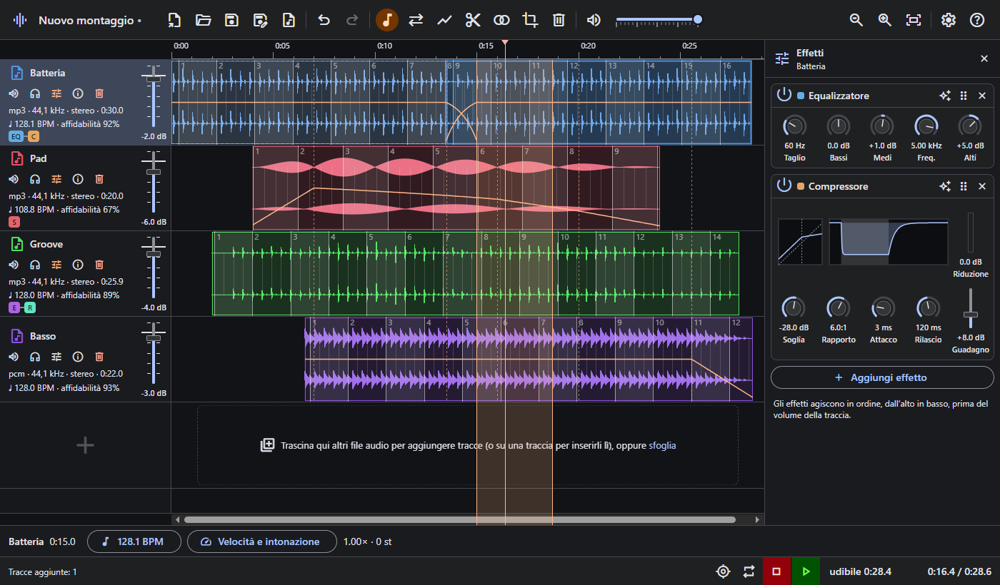

# edimus

**Editor audio multitraccia non distruttivo per Windows, completo da solo e, se vuoi, pilotabile
da un assistente AI.**

Monta, taglia, metti a tempo e mixa i tuoi brani senza mai toccare i file originali: un
*montaggio* (`.edimus`) li richiama e descrive come comporli, e l'export produce il mix finale.



## In evidenza

- **Non distruttivo**: i file audio originali non vengono mai modificati. Ogni operazione si può
  annullare, e il montaggio è un piccolo file da salvare, riaprire e condividere.
- **Assistente AI, se lo vuoi**: tutto si fa con mouse e tastiera, ma chi usa Claude, Cursor,
  Copilot, Gemini o altri può anche chiedere all'assistente di aprire, ascoltare, analizzare,
  modificare ed esportare il montaggio mentre lo guarda. Basta un clic per configurarli, e ogni
  modifica dell'AI è un normale passo di annulla.
- **Tempo e battute**: BPM rilevati in automatico, griglia delle battute con aggancio delle clip,
  correzione a mano e **brani a tempo variabile** che la griglia segue battuta per battuta.
  L'allineamento automatico mette a tempo più tracce tra loro.
- **Velocità e intonazione di qualità**: time-stretch con Rubber Band (cambia la velocità, non
  l'intonazione) oppure varispeed come un nastro, clip per clip.
- **Volume preciso**: inviluppo per clip con curve, fade e dissolvenze incrociate che seguono la
  clip, più il volume per traccia.
- **Effetti per traccia**: equalizzatore, compressore, eco a tempo, riverbero e saturazione, con
  preset e controlli in stile studio; si sentono mentre li regoli. Dettagli in
  [docs/effects.md](docs/effects.md).
- **Portabile e sempre aggiornato**: è una cartella da copiare, senza installazione. All'avvio
  propone le nuove versioni e, con la tua conferma, si aggiorna da solo.
- **Anche nel browser**: la versione web lavora tutta sul tuo computer, e i file audio non vengono
  mai caricati su un server.

## Scarica e usa

1. Scarica l'ultima versione dalle [Releases](https://github.com/leolmi/edimus/releases) ed
   estraila in una cartella qualsiasi.
2. Avvia `edimus.exe`. Serve il WebView2 Runtime, già presente su Windows 11 e sui Windows 10
   aggiornati.
3. Al primo avvio edimus propone di scaricare ffmpeg, che usa per leggere ed esportare l'audio:
   la build GPL “essentials” di [gyan.dev](https://www.gyan.dev/ffmpeg/builds/) (con Rubber Band
   e libmp3lame), circa 110 MB, alla versione legata a quella di edimus. In alternativa copia a
   mano `ffmpeg.exe` e `ffprobe.exe` nella cartella dell'app.

La guida completa è nell'app: pulsante **?** o tasto F1, schede *Guida* e *Come fare*.

### Sicurezza e trasparenza

Scaricare un eseguibile che non passa da un installatore può lasciare qualche dubbio, ed è
giusto porselo. edimus prova a toglierlo nel modo più semplice: **tutto il codice è qui, pubblico**.
Non ci sono parti nascoste, servizi remoti che raccolgono dati né account da creare. L'app lavora
solo sui file che apri tu e si collega a internet soltanto per tre cose, tutte visibili nel codice
e tutte soggette alla tua conferma o disattivabili:

- controllare se c'è una nuova versione tra le release di questo repository;
- scaricare l'aggiornamento, verificato con il suo SHA-256 prima di installarlo;
- scaricare ffmpeg dalla sua distribuzione originale (il mirror GitHub ufficiale di gyan.dev),
  anch'esso verificato con SHA-256.

Il collegamento con un assistente AI resta sul tuo PC: passa dall'indirizzo locale `127.0.0.1`.

Chiunque può controllare cosa fa davvero il programma. Se non hai tempo o competenze per leggere
il codice, puoi chiedere a un assistente AI di analizzare il repository e dirti se fa qualcosa di
diverso da quello che dichiara: è un modo concreto, alla portata di tutti, per non doversi fidare
sulla parola. I punti da cui partire sono la gestione dei file (`src/platform/`), l'aggiornamento
(`neutralino-updater.ts`, `update-script.ts`) e il server MCP (`mcp/`).

Le release sono compilate da questo stesso codice, a partire dal commit indicato dal loro tag.
Gli eseguibili non sono firmati digitalmente, quindi Windows può mostrare un avviso al primo
avvio. Chi preferisce non fidarsi neanche dei file già pronti può compilare edimus da sé con i
comandi della sezione [Sviluppo](#sviluppo) e ottenere lo stesso programma.

## Funzionalità

**Montaggio e file**
- Apre qualsiasi formato letto da ffmpeg (wav, mp3, flac, ogg, opus, m4a, aiff, wma…), anche
  trascinando i file sulla finestra; montaggi recenti a portata di clic.
- **Pacchetto `.edimuspack`**: il montaggio con i suoi file audio in un unico file da inviare.
- **File mancanti ritrovati dal contenuto**: se un file audio è stato spostato o rinominato,
  edimus lo riconosce e lo ricollega.
- Export in wav, mp3, flac, ogg, opus e m4a, mono o stereo, con normalizzazione e silenzio finale.

**Editing**
- Clip trascinabili tra le tracce, trim dei bordi, divisione, ritaglio ed eliminazione di un
  intervallo su tutte le tracce, mute e solo per traccia.
- Aggancio alla griglia delle battute, ai bordi e ai punti d'inviluppo delle altre clip;
  spostamento fine da tastiera.
- Forma d'onda per canale, con zoom dal singolo campione all'intero brano.

**Ascolto**
- Play, loop di un intervallo, cursore che resta al centro durante l'ascolto, scelta
  dell'uscita audio.
- **Registrazione dall'ingresso** (microfono, scheda audio; solo app desktop) su una traccia, dal
  cursore, con il montaggio come base e la latenza misurata per allineare la ripresa.
- **Durata udibile**: quanto dura il mix senza i silenzi iniziale e finale, selezionabile con un clic.

**Tempo**
- Rilevamento dei BPM, correzione con tap o segnando una battuta sulla forma d'onda, mappa delle
  battute per i brani a tempo non costante, salvata accanto all'audio (`.edimusbars`) e
  riutilizzata da ogni montaggio.
- Allineamento automatico del tempo tra più clip.

**Assistente AI**
- Server [MCP](https://modelcontextprotocol.io) incluso (`edimus-mcp.exe`), registrato con un clic
  in Claude Code, Claude Desktop, Cursor, VS Code, Windsurf, Gemini CLI e Codex CLI.
- L'AI vede lo stato del montaggio e un'immagine della timeline, analizza livelli, silenzi e
  battiti, e usa gli stessi comandi dell'interfaccia. Dettagli in [mcp/README.md](mcp/README.md).

**Interfaccia**
- Tema chiaro, scuro o di sistema; italiano e inglese; guida in linea completa.

## Licenze

Le licenze di tutti i componenti di terze parti sono in
[THIRD_PARTY_LICENSES.md](THIRD_PARTY_LICENSES.md) e nella scheda *Info e licenze* dell'Aiuto
dell'app (rigenerate da `npm run licenses`). ffmpeg non è incluso nelle release: l'app lo scarica,
su richiesta, dalla sua distribuzione originale (licenza GPL).

## Sviluppo

App desktop [Neutralino](https://neutralino.js.org) con frontend Angular (Material M3, signals),
Web Audio API per ascolto e render, ffmpeg/ffprobe esterni per decodifica, stretch e encoding.
La versione web sostituisce ffmpeg con Rubber Band ed encoder wasm. Architettura e modello dati
sono in [docs/](docs/architecture.md).

**Requisiti**: Node.js ≥ 20 e npm; `ffmpeg.exe` e `ffprobe.exe` in `tools/ffmpeg/bin/`
(cartella esclusa da git), con `LICENSE` e `README.txt` in `tools/ffmpeg/`, presi dalla build
fissata in `package.json` (`config.ffmpeg`).

**Avvio**

```bash
npm install
npm run setup
npm run dev
```

`setup` scarica il runtime Neutralino (`bin/`) e genera l'elenco delle licenze; `dev` apre la
finestra dell'app collegata a `ng serve` (porta 47815) con ricarica automatica. `npm run dev:web`
avvia la versione web nel browser; `npm run build:web` la produce in `dist/web/`, da pubblicare
su un hosting statico con gli header COOP/COEP.

**Build**

```bash
npm run package
```

Produce `release/edimus/`, la cartella portabile con `edimus.exe` (risorse incorporate),
`edimus-mcp.exe` (server MCP autonomo), `ffmpeg.exe`, `ffprobe.exe` e le licenze. Produce anche
il pacchetto di aggiornamento `release/edimus-<versione>-win-x64.zip` (senza ffmpeg) con
`release/manifest.json`.

**Release**

```bash
npm run release
```

Pubblica il pacchetto come release GitHub `v<versione>`, da cui le app installate si aggiornano
da sole. Richiede la [GitHub CLI](https://cli.github.com/) (`winget install GitHub.cli`, poi
`gh auth login`); le note della release sono l'argomento (`npm run release -- "testo"`) o
l'oggetto dell'ultimo commit. Dettagli in [docs/architecture.md](docs/architecture.md).
