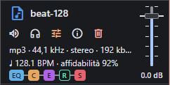
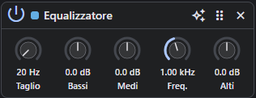
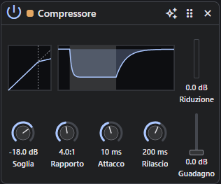
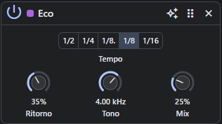
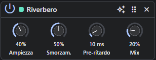
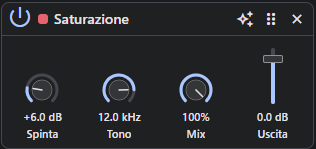

# Effetti

Ogni traccia può avere una **catena di effetti**: agiscono in ordine, dall'alto in basso, sul
suono di tutte le sue clip, prima del volume della traccia. Sono non distruttivi come il resto del
montaggio: sono parametri salvati nel file `.edimus`, i file audio non vengono toccati.

- Il pulsante con i cursori nell'intestazione della traccia apre il **pannello degli effetti** a
  destra (Esc lo chiude). Il pulsante è colorato quando la traccia ha effetti attivi. A pannello
  aperto, selezionando una clip di un'altra traccia il pannello passa agli effetti di quella traccia.
- In fondo all'intestazione la **catena** mostra gli effetti della traccia in ordine: un quadratino
  per effetto con colore e sigla del tipo (**EQ** equalizzatore, **C** compressore, **E** eco,
  **R** riverbero, **S** saturazione), vuoto se l'effetto è escluso. Passandoci sopra il tooltip dà
  il nome e i valori; un clic apre il pannello. Lo stesso colore segna l'effetto nel pannello.

  
- **Aggiungi effetto** in fondo al pannello; la maniglia trascina un effetto più su o più giù
  nella catena; la × lo toglie.
- L'**interruttore** esclude l'effetto (bypass) senza perderne le impostazioni: utile per
  confrontare il suono con e senza.
- Il menu **Preset** offre impostazioni pronte e i *Valori iniziali*.
- Durante l'ascolto ogni regolazione si sente subito; un'intera regolazione è **un solo passo di
  annulla**.
- L'**esportazione** suona esattamente come l'ascolto e tiene le **code** di eco e riverbero dopo la
  fine dell'ultima clip (fino a 15 s), prima dell'eventuale silenzio finale.
- Per un effetto **solo su un pezzo**: dividi la clip e trascina il pezzo sotto l'ultima traccia,
  che diventa una traccia nuova con i suoi effetti.
- Un assistente AI usa gli stessi effetti con gli strumenti MCP `list_effects` e `set_effects`.

## Controlli

| Controllo | Uso |
|---|---|
| **Manopola** | trascina in verticale (con Maiusc più fine), rotellina, frecce; doppio clic torna al valore iniziale; un clic sul valore permette di scriverlo (`1,5k` = 1500 Hz) |
| **Fader** | per i livelli di uscita: trascina o clicca lungo la guida; stessi tasti della manopola |
| **Selettore** | scelta tra pochi valori fissi (la divisione dell'eco) |
| **Interruttore** | effetto attivo o in bypass |
| **Indicatore** | solo lettura: quanto sta comprimendo il compressore durante l'ascolto |
| **Grafico** | solo lettura: la curva e la risposta del compressore secondo i valori impostati |

Le manopole dei parametri che vanno nei due versi (es. ±15 dB) si illuminano a partire dallo 0.

## Effetti disponibili

### Equalizzatore (`eq`)

Corregge il timbro: toglie i rimbombi, dà presenza o calore.

| Parametro | id | Intervallo | Iniziale | Note |
|---|---|---|---|---|
| Taglio | `lowCut` | 20 – 1000 Hz | 20 Hz | filtro passa-alto; a 20 Hz non taglia nulla |
| Bassi | `low` | −15 – +15 dB | 0 dB | scaffale sotto 200 Hz |
| Medi | `mid` | −15 – +15 dB | 0 dB | campana alla frequenza dei medi |
| Freq. | `midFreq` | 200 – 8000 Hz | 1000 Hz | |
| Alti | `high` | −15 – +15 dB | 0 dB | scaffale sopra 4 kHz |

Preset: **Voce**, **Radio** (banda stretta), **Calda**, **Brillante**.

### Compressore (`compressor`)

Riduce la differenza tra parti forti e deboli: una voce più uniforme e presente.

| Parametro | id | Intervallo | Iniziale | Note |
|---|---|---|---|---|
| Soglia | `threshold` | −60 – 0 dB | −18 dB | sopra la soglia il livello viene ridotto |
| Rapporto | `ratio` | 1:1 – 20:1 | 4:1 | quanto riduce (20:1 ≈ limitatore) |
| Attacco | `attack` | 1 – 200 ms | 10 ms | rapidità nel ridurre |
| Rilascio | `release` | 20 – 1000 ms | 200 ms | rapidità nel tornare |
| Guadagno | `makeup` | 0 – +24 dB | 0 dB | fader: recupera il volume perso |

Il **grafico** in alto, accanto all'indicatore di riduzione (con il fader del guadagno sotto), segue i valori mentre li regoli:

- a sinistra la **curva di compressione**: livello in ingresso (orizzontale) contro livello in
  uscita (verticale), con la soglia tratteggiata, la pendenza del rapporto, il ginocchio morbido
  (6 dB) e il guadagno; la diagonale tratteggiata è il suono non compresso;
- a destra la **risposta nel tempo** a un colpo 18 dB sopra la soglia (la fascia chiara, 250 ms): la
  riduzione cresce con l'attacco mentre il colpo dura e torna a zero con il rilascio nell'1,25 s
  successivo. Le due parti hanno scale di tempo fisse, quindi un attacco o un rilascio più lunghi si
  vedono come una pendenza più dolce.

Indicatore: **Riduzione**, in dB, durante l'ascolto. Preset: **Voce**, **Leggero**, **Incisivo**,
**Limitatore**.

### Eco (`echo`)

Ripetizioni del suono **a tempo** con la musica.

| Parametro | id | Intervallo | Iniziale | Note |
|---|---|---|---|---|
| Tempo | `time` | 1/2, 1/4, 1/8., 1/8, 1/16 | 1/8 | divisione di nota (1/8. = ottavo puntato) al tempo della prima clip della traccia (120 BPM se sconosciuto) |
| Ritorno | `feedback` | 0 – 90 % | 35 % | quante ripetizioni |
| Tono | `tone` | 500 – 12000 Hz | 4000 Hz | le ripetizioni si scuriscono via via |
| Mix | `mix` | 0 – 100 % | 25 % | livello delle ripetizioni (il suono originale resta pieno) |

Preset: **Slapback** (una sola ripetizione breve), **Ritmica**, **Puntata**, **Ampia**.

### Riverbero (`reverb`)

Mette il suono in un ambiente, da una stanza a una cattedrale.

| Parametro | id | Intervallo | Iniziale | Note |
|---|---|---|---|---|
| Ampiezza | `size` | 0 – 100 % | 40 % | durata della coda, da 0,3 a 6 s |
| Smorzamento | `damping` | 0 – 100 % | 50 % | quanto si spengono prima gli acuti |
| Pre-ritardo | `predelay` | 0 – 150 ms | 10 ms | distanza tra suono e riverbero |
| Mix | `mix` | 0 – 100 % | 20 % | equilibrio tra suono diretto e riverbero |

Preset: **Stanza**, **Voce**, **Sala**, **Cattedrale**.

### Saturazione (`saturation`)

Calore analogico, fino alla distorsione e al lo-fi.

| Parametro | id | Intervallo | Iniziale | Note |
|---|---|---|---|---|
| Spinta | `drive` | 0 – 30 dB | 6 dB | quanto satura |
| Tono | `tone` | 1000 – 20000 Hz | 12000 Hz | filtro sugli acuti della parte saturata |
| Mix | `mix` | 0 – 100 % | 100 % | equilibrio tra suono pulito e saturato |
| Uscita | `output` | −24 – +6 dB | 0 dB | fader: livello finale |

Preset: **Calda**, **Lo-fi**, **Distorta**.

## Catene consigliate

| Obiettivo | Catena |
|---|---|
| Voce parlata | Equalizzatore *Voce* → Compressore *Voce* → Riverbero *Voce* (Mix basso) |
| Voce cantata | Equalizzatore *Voce* → Compressore *Voce* → Eco *Puntata* → Riverbero *Sala* |
| Effetto radio o telefono | Equalizzatore *Radio* → Saturazione *Lo-fi* |
| Strumento ritmico più incisivo | Compressore *Incisivo* → Saturazione *Calda* |

## Note tecniche

Gli effetti usano i nodi nativi di Web Audio, uguali su desktop e nel browser; la scheda di ogni
effetto (parametri, intervalli, preset) è in `src/app/core/effects/effects.ts`. Dettagli
dell'implementazione in [architecture.md](architecture.md), formato nel file in
[data-model.md](data-model.md). Prossimi passi valutati: bus di effetti condivisi (mandate), vedi
[WISHLIST.md](../WISHLIST.md).
